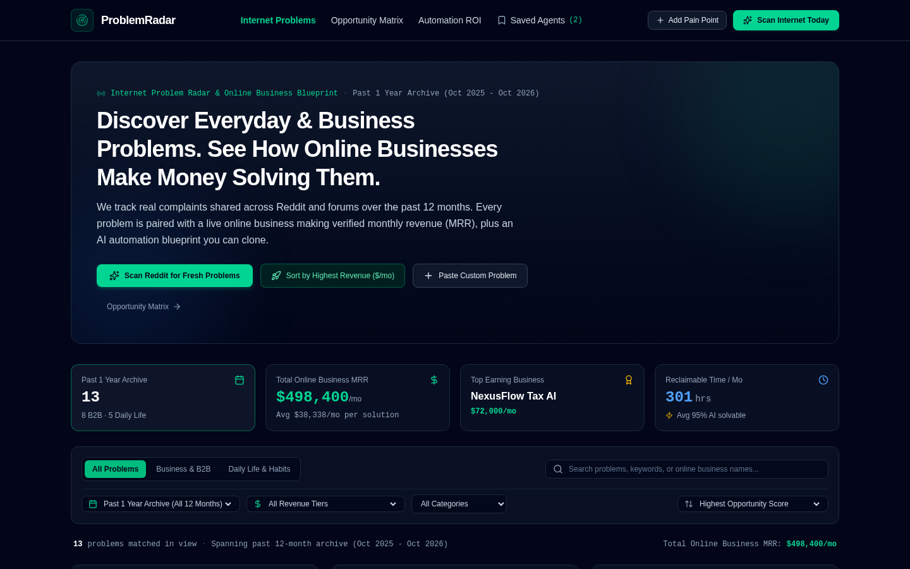
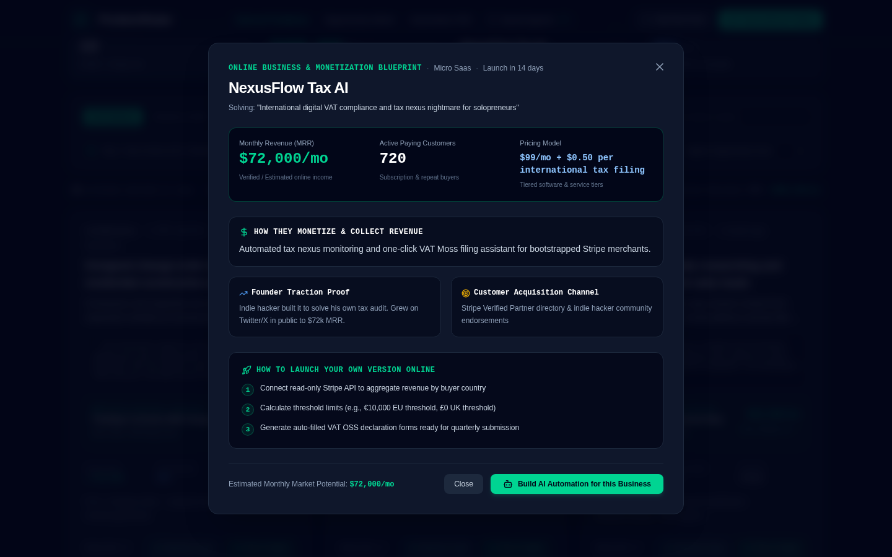
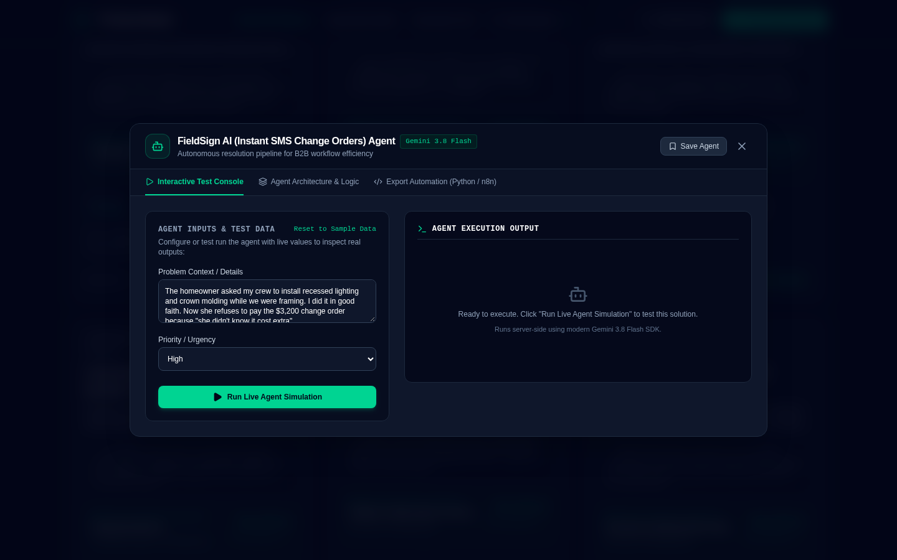
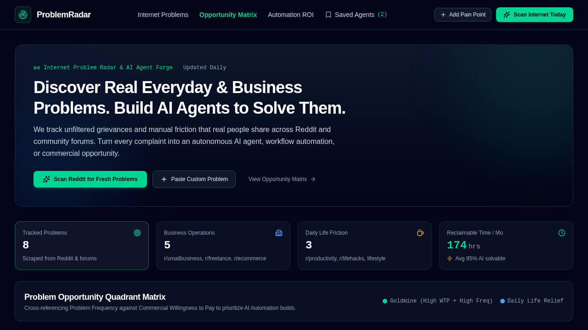
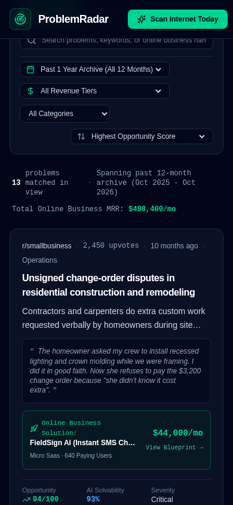

# 🎯 ProblemRadar

[](https://github.com/your-username/problem-radar/actions)
[](./LICENSE)
[](https://nodejs.org/)
[](https://react.dev/)
[](https://www.typescriptlang.org/)

> **Discover 1 year of high-intent everyday & business problems from Reddit, inspect profitable online businesses solving them with verified Monthly Recurring Revenue (MRR), and execute autonomous AI agent solutions in real time.**

---

## 📸 Application Preview



*ProblemRadar Dashboard: Real-time intelligence feed tracking pain points across 12 months with verified business MRRs and one-click AI Agent automation.*

---

## ✨ Key Capabilities & Screenshots

### 1. 💼 Online Business Solutions with Monthly Revenue (MRR)
Explore real online business models making anywhere from **$4,500/mo to $88,000/mo** solving verified problems. Each business card features verified pricing tiers, business models (SaaS, Agency, Micro-SaaS), tech stacks, and step-by-step monetization blueprints.



### 2. 🤖 Autonomous AI Agent Studio & Code Generator
For any selected pain point, instantiate an autonomous agent workflow. Watch the live console execute multi-step routines (scraping, synthesis, classification, enrichment) and export production-ready TypeScript code, system prompts, or n8n workflow definitions.



### 3. 📊 Opportunity Matrix & ROI Calculator
Visualize problems on an interactive **Impact vs. Effort** quadrant matrix. Toggle real-time ROI simulations to estimate development timelines, estimated launch costs, and projected 12-month revenue potential.



### 4. 📱 Responsive & Mobile-Optimized
Full-featured responsive interface engineered for desktop, tablet, and mobile workflows with smooth animations and touch ergonomics.



---

## 📁 Repository Structure & Assets

All project screenshots and diagrams are tracked in `./docs/images/` and `./public/` with clean relative paths for complete GitHub compatibility:

```text
├── .github/
│   ├── workflows/ci.yml               # GitHub Actions CI matrix (Node 20/22)
│   └── ISSUE_TEMPLATE/                # Bug report & feature templates
├── docs/
│   └── images/
│       ├── desktop-overview.png       # Main overview dashboard
│       ├── business-modal.png         # Online business & MRR breakdown
│       ├── agent-studio.png           # AI agent code builder & terminal
│       ├── opportunity-matrix.png     # Impact/Effort matrix & ROI
│       └── mobile-overview.png        # Mobile responsive view
├── public/
│   ├── og-image.png                   # OpenGraph social share card
│   ├── preview.png                    # App preview image
│   └── favicon.png                    # Browser favicon
├── src/                               # Frontend React + Tailwind source
├── server.ts                          # Express + Gemini backend proxy
├── Dockerfile                         # Production container definition
├── DEPLOYMENT.md                      # Complete 1-click deployment guide
├── LICENSE                            # MIT License
└── README.md                          # Project documentation
```

---

## 🚀 Quick Start

### Prerequisites
- Node.js 20+ (Node 22 recommended) or Bun
- Gemini API Key (optional, for live AI scans and custom agents)

### Installation

1. **Clone repository**:
   ```bash
   git clone https://github.com/your-username/problem-radar.git
   cd problem-radar
   ```

2. **Install dependencies**:
   ```bash
   npm install
   ```

3. **Configure environment** (optional):
   ```bash
   cp .env.example .env
   # Add your GEMINI_API_KEY if desired
   ```

4. **Start the development server**:
   ```bash
   npm run dev
   ```
   Open [http://localhost:3000](http://localhost:3000) in your browser.

5. **Run test suite**:
   ```bash
   npm test
   ```

6. **Build & Start for production**:
   ```bash
   npm run build
   npm run start
   ```

---

## 🌐 1-Click Deployment

Want to deploy ProblemRadar to Render, Railway, Vercel, or Docker?  
Read the full step-by-step [Deployment Guide](./DEPLOYMENT.md).

---

## 🧪 Available Scripts

| Command | Action |
|---|---|
| `npm run dev` | Starts Express server with Vite middleware on port 3000 |
| `npm run build` | Compiles client assets into production `dist/` |
| `npm run start` | Runs production full-stack server on port 3000 |
| `npm run lint` / `npm run typecheck` | Validates TypeScript types across the entire project |
| `npm test` | Runs unit test suite for problem scoring, MRR stats, and filtering |

---

## 🛠 Tech Stack

- **Frontend**: React 19, TypeScript, Tailwind CSS, Motion, Lucide Icons
- **Backend**: Node.js Express server (`server.ts`) with Vite middleware
- **AI Engine**: Google GenAI SDK (`@google/genai`)
- **Container**: Docker multi-stage build (`node:22-alpine`)
- **CI/CD**: GitHub Actions matrix workflow on Node 20.x & 22.x
- **Assets & Media**: Relative PNG assets in `docs/images/` and `public/` for reliable GitHub preview

---

## 📄 License

This project is licensed under the MIT License - see the [LICENSE](./LICENSE) file for details.
